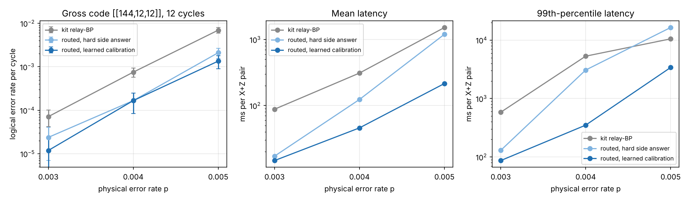
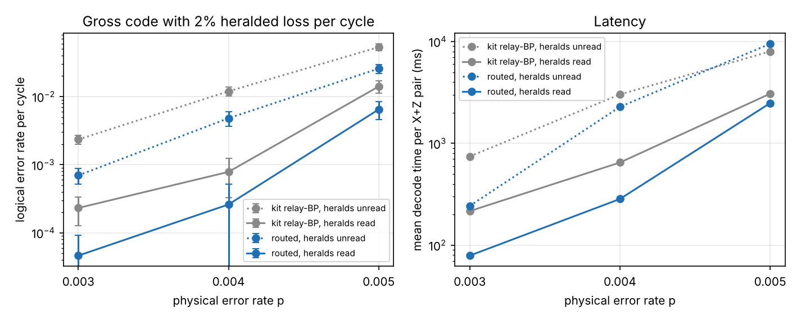

# Routed cross-basis decoding of the [[144,12,12]] Gross code

MidQWest 2026, Infleqtion track, Challenge 1 (ML-assisted QEC decoding).
Baselines: the kit's BP-OSD and relay-BP at the relay-BP authors' settings (`kit/`, unchanged).

Three results, all against the kit's relay-BP on the same shots:

1. **Cross-basis conditioning with a learned calibrator.** 4 to 6 times fewer logical errors at
   every noise level and 6 to 7 times lower mean latency (99th percentile: 3 to 15 times lower).
2. **Heralded loss.** With 2% loss per data qubit per cycle, reading the heralds and routing gives
   8 to 50 times fewer logical errors and 3 to 11 times lower mean latency than the loss-blind baseline.
3. **Where the machine learning is.** A small logistic model calibrates belief-propagation
   posteriors (held-out log loss 3.6 times lower than the raw posteriors). It lets one cheap
   BP pass replace a full relay-BP decode of the side syndrome.

## The idea

The kit decodes X memory from the 936 X-check detectors and ignores the 792 Z-check
detectors of the same shot. Many circuit faults (Y errors, two-qubit gate faults) flip
detectors of both types, so the Z-check syndrome carries information about where the
X-check problem's errors are.

1. **Stage A, cheap pass.** One min-sum leg on the main syndrome with the plain priors.
   If it converges, accept the answer. This ends 62% to 96% of shots in about 10 ms.
2. **Stage S, side beliefs.** One min-sum leg on the other check type's syndrome. Its per-column
   posteriors go through the learned calibrator, which returns the probability that each side
   column fired.
3. **Stage M, conditioned decode.** Relay-BP (first solution) on the main syndrome with priors
   conditioned on those beliefs: a mechanism that shares a side column is rescaled by
   belief / prior. If stage M does not converge, it runs again with the plain priors.

`router/correlated.py` builds the joint model from Stim's detector error model,
`router/learned.py` is the calibrator, `router/decoder.py` is the decoder
(`RoutedDecoder(circuit, basis, calibrator=weights)`), and `router/loss.py` adds heralded loss.

## Results without loss

Paired X and Z memory, 12 cycles, the same shots for every decoder, 2 CPU cores.
A pair fails when either basis fails; rate per cycle = 1 - (1 - P)^(1/12).

| p | pairs | decoder | failures X, Z | rate per cycle | mean ms | median ms | p99 ms |
|---|---|---|---|---|---|---|---|
| 0.003 | 7000 | kit relay-BP | 2, 4 | 7.1e-05 +- 3e-05 | 88 | 54 | 583 |
| 0.003 | 7000 | routed, hard side answer | 0, 2 | 2.4e-05 +- 2e-05 | 17 | 10 | 130 |
| 0.003 | 7000 | routed, soft side beliefs (raw BP) | 0, 1 | 1.2e-05 +- 1e-05 | 15 | 10 | 85 |
| 0.003 | 7000 | routed, learned calibration | 0, 1 | 1.2e-05 +- 1e-05 | 15 | 10 | 87 |
| 0.004 | 2000 | kit relay-BP | 12, 6 | 7.5e-04 +- 2e-04 | 311 | 102 | 5311 |
| 0.004 | 2000 | routed, hard side answer | 2, 2 | 1.7e-04 +- 8e-05 | 124 | 16 | 3075 |
| 0.004 | 2000 | routed, soft side beliefs (raw BP) | 2, 1 | 1.3e-04 +- 7e-05 | 53 | 16 | 419 |
| 0.004 | 2000 | routed, learned calibration | 2, 2 | 1.7e-04 +- 8e-05 | 46 | 16 | 351 |
| 0.005 | 560 | kit relay-BP | 23, 23 | 7.0e-03 +- 1e-03 | 1520 | 408 | 10507 |
| 0.005 | 560 | routed, hard side answer | 5, 9 | 2.1e-03 +- 6e-04 | 1201 | 71 | 16420 |
| 0.005 | 560 | routed, soft side beliefs (raw BP) | 3, 9 | 1.8e-03 +- 5e-04 | 310 | 62 | 7692 |
| 0.005 | 560 | routed, learned calibration | 2, 7 | 1.3e-03 +- 5e-04 | 215 | 62 | 3398 |



For reference, the kit's own BP-OSD runs (10,000 shots per basis, `kit/README.md`) give
4.7e-4, 4.4e-3 and 2.3e-2 per cycle at 0.14, 0.33 and 0.59 s per pair. We did not rerun BP-OSD
on our shots.

- "Hard side answer" is our first version: stage S is a full relay-BP decode of the side syndrome
  and stage M conditions on its hard decision, only when it converged.
- Against the kit's relay-BP, the learned variant has 5.9, 4.4 and 5.4 times fewer logical errors
  at the three noise levels, with 5.9, 6.8 and 7.1 times lower mean latency and 6.7, 15 and 3.1 times
  lower 99th-percentile latency.
- Against our own hard variant it is 1.1, 2.7 and 5.6 times faster on average, and it removes the
  latency tail that made the hard variant worse than the kit at p = 0.005.

### What the learned part contributes

Only the shots stage A does not settle are touched by the side information:

| p | share of basis-shots | variant | failures | mean ms | p99 ms |
|---|---|---|---|---|---|
| 0.003 | 3.5% | hard side answer | 1 | 75 | 888 |
| 0.003 | 3.5% | soft side beliefs (raw BP) | 0 | 38 | 336 |
| 0.003 | 3.5% | learned calibration | 0 | 40 | 365 |
| 0.004 | 13.7% | hard side answer | 3 | 378 | 5338 |
| 0.004 | 13.7% | soft side beliefs (raw BP) | 2 | 122 | 1271 |
| 0.004 | 13.7% | learned calibration | 3 | 94 | 1147 |
| 0.005 | 38.1% | hard side answer | 13 | 1532 | 10808 |
| 0.005 | 38.1% | soft side beliefs (raw BP) | 11 | 364 | 8785 |
| 0.005 | 38.1% | learned calibration | 8 | 240 | 4129 |

- Most of the speedup comes from replacing the side decode by one BP leg and using soft beliefs.
  That step needs no learning.
- The calibrator adds to it where decoding is hard: at p = 0.005 it is 1.5 times faster on average
  than the raw posteriors, halves the 99th percentile, and has 8 failures against 11. The failure
  difference is 3 shots and is not statistically significant. At p = 0.003 and 0.004 raw and
  learned are equal within noise.
- The calibrator itself is clearly better calibrated: on held-out shots its log loss per column
  is 0.0170, against 0.0612 for the raw BP posterior and 0.0398 for the prior alone. Raw BP
  posteriors on this code are overconfident to the point of being worse than the prior.
- Model: logistic regression on 8 per-column features (the leg's posterior, whether the leg
  converged, the prior, the syndrome weight). Trained on 519 shots sampled from the detector error
  model at p = 0.004 and 0.005, where the true fired mechanisms are known
  (`scripts/train_calibrator.py`, about one minute on a laptop). 8 weights, no GPU.

## Results with qubit loss

Loss model (`router/loss.py`): before every syndrome cycle each data qubit is lost with
probability 2%, detected, and replaced by a fresh qubit in the maximally mixed state (Stim's
`HERALDED_ERASE`). About 35 heralds fire per shot. A decoder that reads the heralds sets the
mechanisms of a heralded location to their conditional probability and switches off the
mechanisms of every location that did not herald. This is exact Bayesian conditioning and needs
no learning.

| p | pairs | decoder | failures X, Z | rate per cycle | mean ms | median ms | p99 ms |
|---|---|---|---|---|---|---|---|
| 0.003 | 1800 | kit relay-BP, heralds unread | 29, 22 | 2.3e-03 +- 3e-04 | 744 | 179 | 9533 |
| 0.003 | 1800 | kit relay-BP, heralds read | 3, 2 | 2.3e-04 +- 1e-04 | 216 | 118 | 2211 |
| 0.003 | 1800 | routed, heralds unread | 9, 7 | 7.0e-04 +- 2e-04 | 243 | 34 | 4656 |
| 0.003 | 1800 | routed, heralds read | 0, 1 | 4.6e-05 +- 5e-05 | 79 | 37 | 539 |
| 0.004 | 320 | kit relay-BP, heralds unread | 22, 25 | 1.2e-02 +- 2e-03 | 3023 | 958 | 17489 |
| 0.004 | 320 | kit relay-BP, heralds read | 2, 1 | 7.8e-04 +- 5e-04 | 649 | 213 | 7560 |
| 0.004 | 320 | routed, heralds unread | 10, 10 | 4.8e-03 +- 1e-03 | 2285 | 157 | 25641 |
| 0.004 | 320 | routed, heralds read | 1, 0 | 2.6e-04 +- 3e-04 | 284 | 47 | 5195 |
| 0.005 | 160 | kit relay-BP, heralds unread | 44, 49 | 5.3e-02 +- 6e-03 | 7991 | 6571 | 24814 |
| 0.005 | 160 | kit relay-BP, heralds read | 14, 15 | 1.4e-02 +- 3e-03 | 3074 | 859 | 18759 |
| 0.005 | 160 | routed, heralds unread | 27, 30 | 2.6e-02 +- 4e-03 | 9497 | 5752 | 46371 |
| 0.005 | 160 | routed, heralds read | 10, 5 | 6.5e-03 +- 2e-03 | 2483 | 266 | 32635 |



- Reading the heralds is worth more than any decoder change: it cuts the kit's own relay-BP
  failures by 4 to 15 times and its latency by 2.6 to 4.7 times.
- Routing and cross-basis conditioning add to it. Against the loss-blind kit baseline the routed,
  herald-aware decoder has 50, 46 and 8 times fewer logical errors and 9.4, 11 and 3.2 times lower
  mean latency.
- The routed decoder in this table uses the hard side answer (it was run before the calibrator
  existed). The four decoders were timed together while other jobs shared the two cores, so the
  ratios are like for like and the absolute times are pessimistic.

## Resources

CPU only, one core per shot. Per basis: one min-sum decoder for stage A (936 x 8784), one for the
side leg (792 x 7992), one relay-BP decoder for the fallback, and a relay-BP decoder rebuilt with
the conditioned priors for each shot that reaches stage M (13 ms). The calibrator is 8 floats.
With loss, the herald-aware decoders are rebuilt per shot; that time is included above.

## Where it falls short

- Failure counts are small (1 to 9 pairs for the learned variant), so the improvement factors
  have wide error bars. The learned-versus-raw difference in failures is within noise.
- The 99th-percentile latency at p = 0.005 is still seconds: the hardest shots need many relay legs.
- The calibrator was trained at p = 0.004 and 0.005 and applied unchanged at 0.003. It was not
  retrained for the lossy circuits, and the loss table does not use it.
- The loss model is heralded erasure with replacement. It does not model a lost atom staying lost
  through later gates, undetected loss, or false heralds.
- The routing rule for stage A is fixed (accept when the cheap pass converges). Three
  converged-but-wrong shots appeared in 19,120 basis-shots; a learned gate to catch them needs far
  more data than we generated.
- Things we tried that did not help are kept in `router/gate.py` and `router/policy.py`: a logistic
  gate choosing between relay-BP's first solution and its best-of-5 (AUC about 0.8 across noise
  levels, but no better than mixing the two decoders), and a selector between the two answers.

## Reproduce

```bash
pip install -r kit/requirements.txt pytest matplotlib   # relay-bp needs a Rust toolchain
python -m pytest tests
# baseline and first version (hard side answer)
for b in X Z; do
  python scripts/eval_corr.py --basis $b --p 0.004 --shots 2000 --workers 2 --out results/corr_${b}_0.004.npz
  python scripts/eval_corr.py --basis $b --p 0.004 --shots 2000 --workers 2 --skip_base --out results/afirst_${b}_0.004.npz
done    # repeat for p = 0.003 (7000 shots) and p = 0.005 (560 shots)
# learned calibrator: train, then compare hard / raw / learned on the same shots
python scripts/train_calibrator.py --p 0.004 0.005 --shots 500 --seed 101
python scripts/eval_soft.py --basis X --p 0.004 --shots 2000 --seed 21 --start 0 --stop 500 --skip plain \
       --out results/soft/X_0.004_s21_0000.npz      # one slice; see the file names in results/soft
python scripts/summarize_soft.py
# heralded loss
./scripts/run_loss_sweep.sh 4500 0.02
python scripts/summarize_loss.py
```

`eval_corr.py`, `eval_soft.py` and `eval_loss.py` sample shots with fixed seeds, run every decoder
on each shot, and store per-shot outcomes and timings. `summarize_*.py` print the tables above and
draw the plots.

## Credits

`kit/` is Infleqtion's challenge kit. Relay-BP: Müller et al., arXiv:2506.01779.
Gross code: Bravyi et al., Nature 627, 778 (2024).
